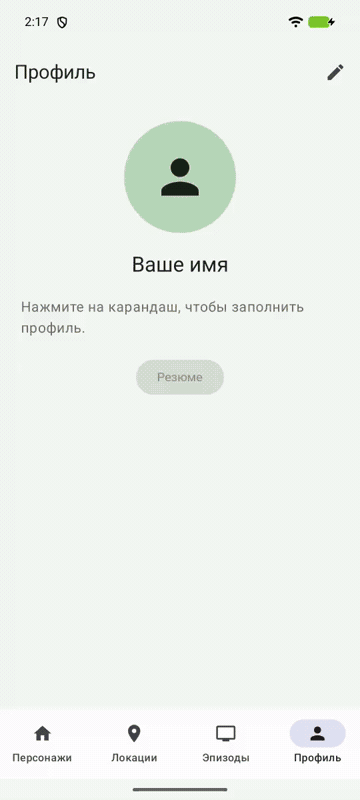
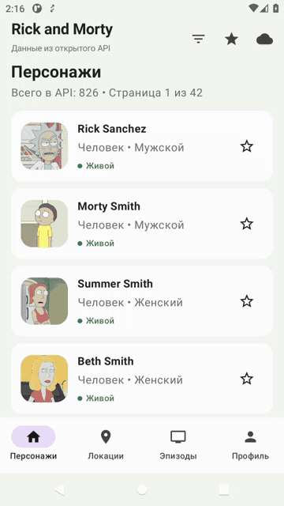

# Последовательные практики Android

## Выполненные работы

- [Практика 3 — «Список с деталями»](SUBMISSION_PRACTICE3.md)
- [Практика 4 — «Работа с сетью»](SUBMISSION_PRACTICE4.md): [видео работы](docs/practice4-demo.webm) и [история запросов Chucker](docs/practice4-network.png)
- [Практика 5 — «Локальное хранение данных»](SUBMISSION_PRACTICE5.md): [сохранение фильтров](docs/practice5-filters.webm), [избранное без сети](docs/practice5-favorites.webm)
- [Практика 6 — «Профиль»](SUBMISSION_PRACTICE6.md): профиль, фото из галереи/камеры и открытие PDF.

### Практика 6 — демонстрация

Редактирование профиля, выбор фото, камера, сохранение и открытие скачанного PDF:

Отказ в доступе возвращает на профиль; разрешение открывает редактор (Android 11):

[Видео MP4](docs/practice6-profile.mp4) · [Описание реализации и проверки](SUBMISSION_PRACTICE6.md)

### Чему научимся
Мы будем грузить информацию из сети, научимся работать со списками, навигацией,
сохранением настроек и долгосрочным хранением данных, приправив это слоеной архитектурой
и паттернами уровня представления на примере списка фильмов, футбольных матчей или репозиториев
в Гитхабе.

### Выполнение и сдача работ

Следующие практики выполняются друг за другом в одном проекте, дополняя приложение новыми возможностями.

Создайте репозиторий на своей личной странице (сделайте его публичным или приватным, выдав доступ @dekabrsky).
Первым делом создайте новый проект в Android Studio и закоммитьте в master как первый коммит.
Теперь можно приступать к заданиям из списка в конце этого текста.

Созданный проект пушится в Github, а ссылка на него прикрепляется в Ведомость:
[https://docs.google.com/spreadsheets/d/14sYlIETeD42pZADhAp7ehKcnl5Ms2v2hhikR6PAkIO8/edit?usp=sharing](https://docs.google.com/spreadsheets/d/10Apr5Xiyydo7U4O7x2MdDS2OQenah9TEcYdbZ2iJE5I/edit?usp=sharing)
(Лист Github, столбец "Ссылка на репо с практиками")

Перед началом каждой практики стартуется новая ветка (practice3 и т.д.). 
Задание выполняете в ветке, затем commit, push и создаете merge-request в master/main. 
Коммитов может быть несколько, для своего удобства в конце работы можете сделать squash. 
Ссылка на merge-request прикладывается в ту же гугл-таблицу в соответсвующий столбец - 
так я могу посмотреть. Как только я пишу ОК в комментарии реквеста или объявляю на паре, что 
сдача практики закрыта, можно вливать merge-request в мастер и стартовать новую ветку для 
следующей практики. 

В merge-request, помимо самого решения, прикладывается пример работы (gif, webm), 
что там должно быть, указывается в самом задании. 

### Практики

1. [Список с деталями](https://github.com/MobileDevelopmentUrfuAutumn2024/ConsecutivePracticesReadme/blob/main/Practice3.md)
2. [Работа с сетью](https://github.com/MobileDevelopmentUrfuAutumn2024/ConsecutivePracticesReadme/blob/main/Practice4.md)
3. [Локальное хранение данных](https://github.com/MobileDevelopmentUrfuAutumn2024/ConsecutivePracticesReadme/blob/main/Practice5.md)
4. [Профиль](https://github.com/MobileDevelopmentUrfuAutumn2024/ConsecutivePracticesReadme/blob/main/Practice6.md)
5. [Время любимой пары (Уведомления)](https://github.com/MobileDevelopmentUrfuAutumn2024/ConsecutivePracticesReadme/blob/main/Practice7.md)
6. [Многомодульность](https://github.com/AndroidDevelopmentUrfuSpring25/ConsecutivePracticesReadme/blob/main/Practice%208.md)

[Итоговый проект](https://github.com/MobileDevelopmentUrfuAutumn2024/ConsecutivePracticesReadme/blob/main/FinalProject.md)
