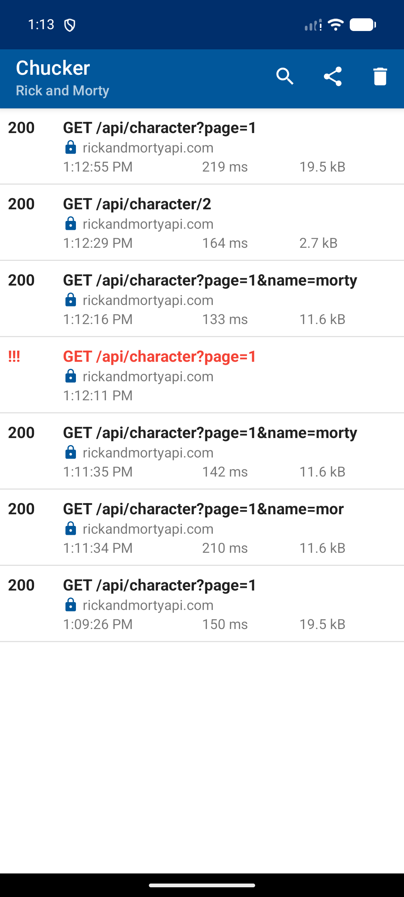

# Практика 4 — работа с сетью

Приложение загружает персонажей из [Rick and Morty API](https://rickandmortyapi.com/documentation) и показывает состояния загрузки, успешного ответа и ошибки сети.

## Что реализовано

- асинхронные запросы через Retrofit и Kotlin Coroutines;
- управление запросами и UI-состоянием во `ViewModel` через `StateFlow`;
- разделение на слои `data`, `domain` и `ui`;
- цепочка `CharacterApi → CharacterRepository → UseCase → ViewModel → Compose UI`;
- серверный поиск по имени с задержкой 500 мс;
- постраничная навигация по результатам API;
- загрузка подробной информации о персонаже отдельным запросом;
- состояния загрузки и ошибки с кнопкой повторного запроса;
- изображения персонажей через Coil;
- просмотр истории HTTP-запросов через Chucker по кнопке с облаком.

## Настраиваемые запросы

- `GET /character?page={page}&name={name}` — параметры `page` и `name` передаются через `@Query`;
- `GET /character/{id}` — идентификатор персонажа передаётся через `@Path`.

## Архитектура

- `data/remote` — Retrofit API и DTO;
- `data` — маппинг DTO и реализация репозитория;
- `domain` — интерфейс репозитория и сценарии загрузки списка/деталей;
- `ui` — ViewModel, UI-состояния и экраны Jetpack Compose;
- `di/AppContainer` — создание сетевых и доменных зависимостей.

Каждый экран создаёт свою ViewModel; ID для деталей приходит через `SavedStateHandle`.
Запросы списка и деталей используют общий `requestErrorHandler` на основе `CoroutineExceptionHandler`.
Он показывает обычные ошибки запросов в UI, не превращает отмену корутины в ошибку сети
и передаёт критические `Error` дальше.

## Проверка

- `gradlew.bat testDebugUnitTest lintDebug assembleDebug assembleRelease` — успешно;
- 11 unit-тестов: маппинг, поиск, отмена запроса, ID деталей, ошибки/повторная загрузка обоих экранов и обработка критического `Error`;
- ручная проверка поиска, пагинации, экрана деталей и повторной загрузки на эмуляторе;
- ручная проверка ошибки при отключённых Wi-Fi и мобильной передаче данных.

## Материалы сдачи

[Смотреть демонстрацию приложения (WebM)](docs/practice4-demo.webm)

[Открыть скриншот истории запросов Chucker](docs/practice4-network.png)

