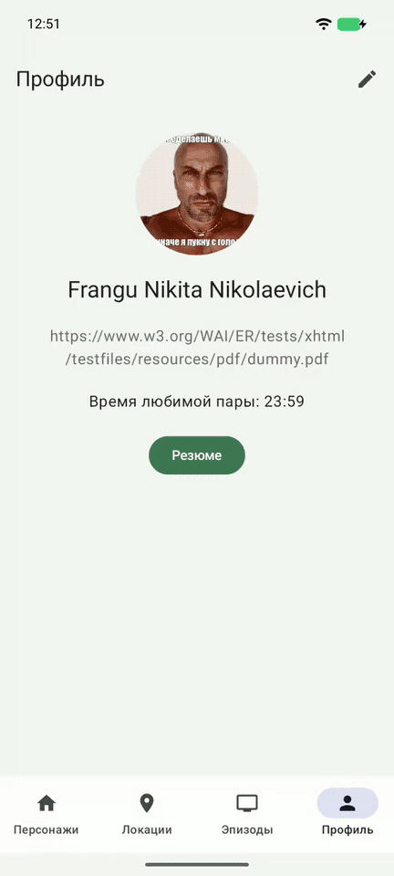

# Практика 7 — «Время любимой пары»

Франгу Никита Николаевич · Rick and Morty API

[Задание](https://github.com/AndroidUrfuAutumn2025/ConsecutivePracticesReadme/blob/main/Practice7.md).
Ветка `practice7`, база PR — `practice6`.

## Реализация

- В редактор профиля добавлено обязательное поле «Время любимой пары»: ввод с клавиатуры и `TimePickerDialog` по иконке часов.
- Допускается только `HH:mm` от `00:00` до `23:59`. Пустое или неверное значение показывает ошибку под полем и блокирует «Готово».
- Напоминание однократное, на сегодняшний день по времени устройства. Прошедшее время отклоняется с объяснением.
- `AlarmManager.setExactAndAllowWhileIdle` вызывает закрытый `BroadcastReceiver`. Тот создаёт уведомление через `NotificationManager` и `NotificationChannel`.
- Имя берётся из сохранённого профиля и передаётся в `PendingIntent`: последующее редактирование черновика не меняет имя уже установленного напоминания. Новое сохранение заменяет предыдущее напоминание.
- Нажатие на уведомление открывает приложение, уведомление убирается из шторки.
- На Android 13+ запрашивается `POST_NOTIFICATIONS`, на Android 12+ проверяется доступ к точным напоминаниям. При отказе можно открыть настройки; сохранение продолжается после разрешения и повторного нажатия «Готово».
- Время хранится вместе с профилем в SharedPreferences, черновик — в `SavedStateHandle`. Новые библиотеки не добавлены.

Обычное завершение фонового процесса не отменяет напоминание. После принудительной остановки приложения в системных настройках или перезагрузки устройства его нужно установить заново.

## Демонстрация



[Скачать видео MP4, 0,39 МБ](docs/practice7-reminder.mp4). Длительность — 67 секунд, GIF — около 3 МБ.
GIF воспроизводится прямо на GitHub. Пауза ожидания сокращена, скорость увеличена в 1,4 раза; время устройства не переводилось, уведомление сработало по установленному AlarmManager.

В записи показаны все пять пунктов задания: ручной ввод, часы, проверка формата, получение уведомления, открытие приложения по нажатию.

## Проверки

```text
gradlew.bat testDebugUnitTest lintDebug assembleDebug assembleRelease
```

25 unit-тестов прошли. Обе сборки успешны, lint — 0 ошибок и 10 предупреждений о доступных обновлениях зависимостей.

Тесты проверяют границы формата времени, запрет пустого/неверного/прошедшего времени, сегодняшнюю дату с часовым поясом, имя владельца, восстановление черновика и повтор после ошибки разрешения.

На Pixel 8 / Android 17 (API 37.1) проверены:

- блокировка сохранения при пустом поле и `24:90` / `25:70`;
- ручной ввод, отмена часов без изменения значения и выбор с циферблата;
- сохранение черновика после поворота экрана;
- отказ и выдача разрешений на уведомления и точные напоминания;
- замена предыдущего будильника: в AlarmManager остаётся одна запись;
- срабатывание после завершения фонового процесса приложения;
- переход по уведомлению и сохранность имени, фото и времени после восстановления процесса.
